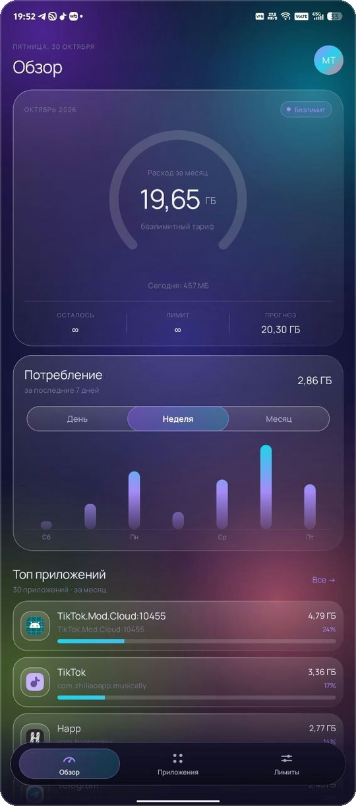
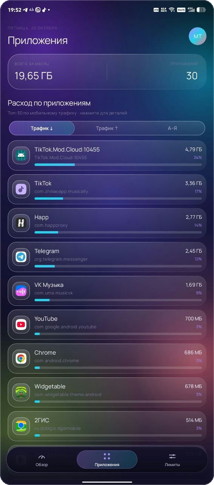
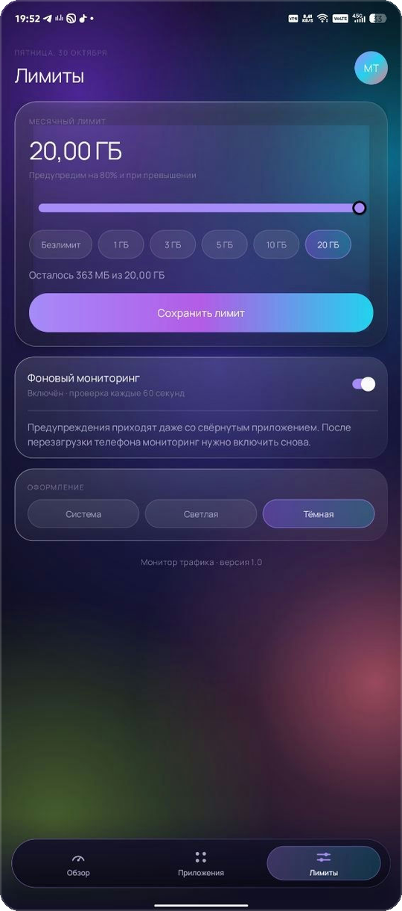

# Монитор трафика

**Android-приложение для контроля мобильного интернета — в стиле Liquid Neon Glass.**

Kotlin · XML + ViewBinding · minSdk 23 · targetSdk 34

[](https://kotlinlang.org)
[](https://developer.android.com)
[](LICENSE)

---

## О проекте

«Монитор трафика» показывает расход мобильного интернета за месяц: общий объём, динамику по дням, неделям и часам, распределение по приложениям и прогресс относительно лимита.

Интерфейс переработан с нуля: тёмная неоновая тема по умолчанию, анимированный mesh-градиент, полупрозрачные стеклянные карточки, крупная типографика Manrope и аккуратные микроанимации. Вся работа с данными осталась прежней — изменился только визуальный слой.

| Обзор | Приложения | Лимиты |
|:---:|:---:|:---:|
|  |  |  |

---

## Возможности

- **Liquid Glass UI** — стеклянные карточки с градиентной обводкой и бликом, анимированный mesh-фон, неоновая палитра.
- **Дуговой индикатор** — градиентная дуга 270°, свечение, count-up числа и цветовые состояния: бирюза → янтарь (80%) → коралл (100%) с пульсацией.
- **График расхода** — столбцы с градиентом, переключатель **День / Неделя / Месяц**, анимация появления.
- **Список приложений** — сортировка **Трафик ↓ / Трафик ↑ / А–Я**, градиентные прогресс-бары, staggered-появление.
- **Карточка приложения** — по нажатию: расход за месяц, доля от общего трафика, тип приложения, UID и быстрый переход в системные настройки.
- **Лимиты** — слайдер 0–20 ГБ, пресеты, режим **«Безлимит»**, предупреждения на 80% и при превышении.
- **Темы** — тёмная (по умолчанию), светлая пастельная и системная; переключение без перезапуска вручную.
- **Фоновый мониторинг** — foreground service с постоянным уведомлением и предупреждениями о лимите.
- **UX** — edge-to-edge с insets, тач-таргеты от 44–48dp, press-scale 0.96 + haptic, skeleton/shimmer и pull-to-refresh.

---

## Экраны

### Обзор
Кольцо расхода, остаток/лимит/прогноз, расход за сегодня, график за выбранный период и топ-5 приложений.

### Приложения
Полный список (топ-30) с выбором сортировки и карточкой деталей при нажатии.

### Лимиты
Слайдер лимита, быстрые пресеты (включая «Безлимит»), сохранение, фоновый мониторинг и выбор темы.

---

## Стек и архитектура

- **Kotlin 1.9.22**, **Android Gradle Plugin 8.2.2**, Java 17.
- **XML + ViewBinding**, Material 3 — без Jetpack Compose.
- `NetworkStatsManager` — системная статистика мобильного трафика (`TYPE_MOBILE`).
- `Foreground Service` — обновление уведомления и проверка лимита раз в минуту.
- `SharedPreferences` — лимит, настройки мониторинга и темы.
- `RecyclerView` — список приложений с кастомным адаптером.
- Кастомные view на Canvas: `GlassLayout`, `MeshBackgroundView`, `GradientRingView`, `UsageChartView`, `GlassSegmentedControl`, `GlassBottomBar`, `CountUpTextView`, `ShimmerView`.
- `TrafficRepository` — чтение статистики, `TrafficSeriesRepository` — только чтение рядов для графика.

```
app/src/main/java/com/example/trafficmonitor/
├── MainActivity.kt              # экраны, состояния, лимит, темы
├── TrafficApp.kt                # применение темы до старта Activity
├── TrafficRepository.kt         # статистика через NetworkStatsManager
├── TrafficSeriesRepository.kt   # ряды для графика (день/неделя/месяц)
├── TrafficMonitorService.kt     # foreground-сервис и уведомления
├── AppUsageAdapter.kt           # список приложений
├── Prefs.kt                     # лимит, мониторинг, тема
├── Format.kt                    # форматирование байтов
└── ui/                          # кастомные view и микроанимации
```

---

## Сборка

```bash
git clone https://github.com/skerdonovandruha-creator/traffic-monitor.git
cd traffic-monitor
./gradlew assembleDebug
```

APK появится в `app/build/outputs/apk/debug/app-debug.apk`.

Либо откройте папку проекта в Android Studio и дождитесь синхронизации Gradle.

**Требования:** Android Studio с JDK 17, Android SDK 34.

---

## Разрешения и первый запуск

1. Установите приложение и откройте его.
2. Нажмите **«Разрешить»** в плашке и включите доступ к статистике использования для «Монитор трафика».
3. Вернитесь в приложение — появятся расход за месяц и список приложений.
4. Задайте лимит слайдером или пресетом (**«Безлимит»** отключает предупреждения).
5. Включите **«Фоновый мониторинг»** и разрешите уведомления (Android 13+).

Приложение учитывает только мобильный интернет (`TYPE_MOBILE`); Wi-Fi не входит в статистику. Без доступа к Usage Access Android не отдаёт данные о трафике по приложениям — это системное ограничение.

---

## Дизайн-система

| Роль | Тёмная тема | Светлая тема |
|---|---|---|
| Фон | `#07060F` → `#14122B` | `#F8F5FF` → `#EEF3FF` |
| Стекло | `#1FFFFFFF` → `#0AFFFFFF` | `#D9FFFFFF` → `#A6FFFFFF` |
| Обводка | `#73FFFFFF` → `#0FFFFFFF` | `#FFFFFF` → `#66FFFFFF` |
| Основной текст | `#F5F2FF` | `#1A1330` |
| Фиолетовый | `#A78BFA` | `#7C3AED` |
| Бирюза | `#22D3EE` | `#0891B2` |
| Коралл | `#FB7185` | `#E11D48` |

Типографика — **Manrope** (400/500/600/700/800), скругления 22–32dp.

---

## Статус

- `./gradlew assembleDebug` — успешно.
- `./gradlew lintDebug` — 0 errors.
- Проверено на реальном устройстве; превью в README — скриншоты с телефона.

---

## Лицензия

[MIT](LICENSE) © 2026 skerdonovandruha-creator
